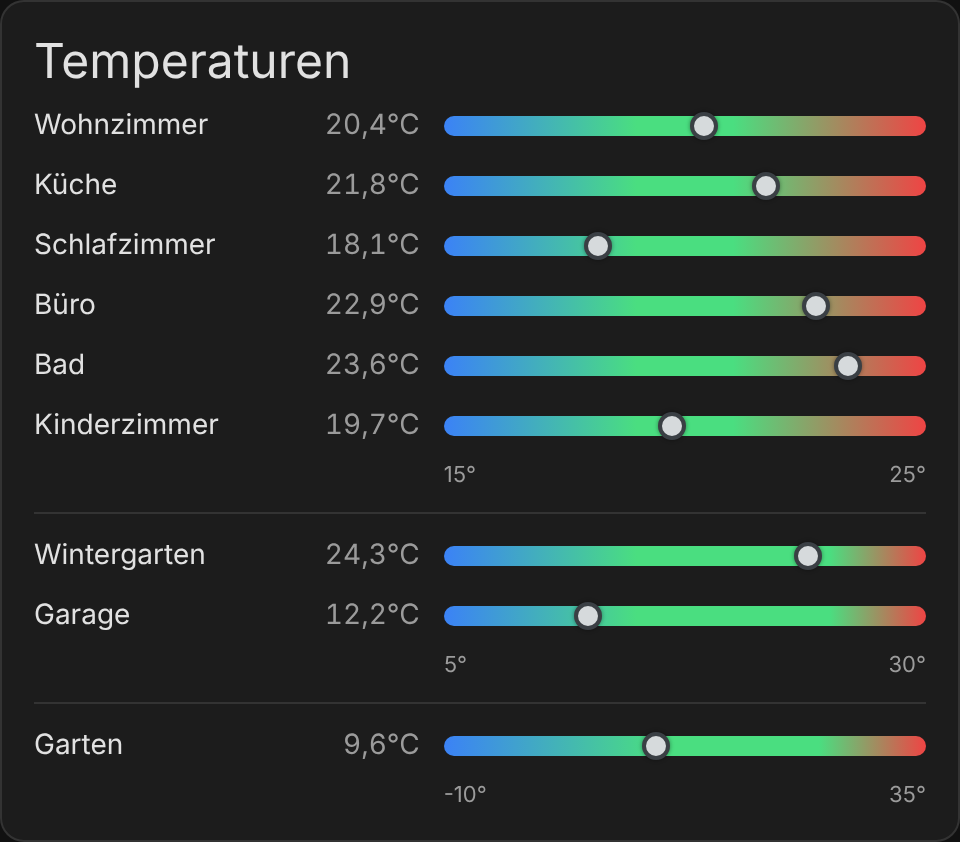

# Temperature Overview Bars Card

[English](README.md)



Home-Assistant-Dashboard-Karte, die die Raumtemperaturen als Balken mit Farbverlauf anzeigt (Optik angelehnt an die Wettervorhersage-Karte).

- Skala standardmäßig **15–25 °C**
- Farbverlauf: unter 19 °C blau, **19–21 °C grün**, darüber rot, mit fließenden Übergängen
- Ein Punkt markiert die aktuelle Temperatur, der Wert steht links neben dem Balken
- Räume sind in **Gruppen** organisiert (z. B. beheizt, unbeheizt, außen). Zwischen den Gruppen steht nur eine dünne Trennlinie, jede Gruppe kann eine **eigene Skala** haben
- Pro Raum eine **priorisierte Sensorliste**: der erste Sensor mit gültigem Wert wird angezeigt (z. B. Zigbee zuerst, Homematic als Fallback)
- Klick auf eine Zeile öffnet die Detailansicht des verwendeten Sensors
- Vollständig über den **visuellen Editor** konfigurierbar, nichts ist vorbelegt
- Karte und Editor erscheinen auf Deutsch, wenn die Benutzersprache in Home Assistant Deutsch ist, sonst auf Englisch

## Installation über HACS

1. HACS → Menü (drei Punkte) → **Benutzerdefinierte Repositories**
2. Repository-URL eintragen, Typ **Dashboard** (früher „Lovelace") wählen
3. „Temperature Overview Bars Card" herunterladen, Browser-Cache neu laden (Strg+F5)

Die Ressource wird von HACS automatisch eingetragen. Manuell wäre es `/hacsfiles/<repo-name>/temperature-bars-card.js` als Typ *JavaScript-Modul*.

Bei einem Update in HACS auf „Aktualisieren" klicken und danach den Browser-Cache neu laden.

## Einrichtung

1. Dashboard bearbeiten → Karte hinzufügen → **Temperature Overview Bars Card**
2. Mit **+ Gruppe hinzufügen** eine Gruppe anlegen (der Gruppenname dient nur der Übersicht im Editor). Optional eigene Skalenwerte eintragen, leere Felder übernehmen die Standardskala vom Kartenanfang.
3. In der Gruppe mit **+ Raum hinzufügen** einen Raum anlegen und den HA-Bereich auswählen. Der Anzeigename ist optional, sonst wird der Bereichsname verwendet.
4. Mit **+ Sensor** Sensoren auswählen. Angeboten werden standardmäßig nur die Temperatursensoren des gewählten Bereichs. Über die Checkbox lassen sich alle Temperatursensoren anzeigen.
5. **Sensoren des Bereichs übernehmen** fügt alle Temperatursensoren des Bereichs auf einmal hinzu, Homematic-Sensoren landen dabei zuletzt. Die Reihenfolge von Sensoren, Räumen und Gruppen lässt sich mit ▲ ▼ anpassen.

## YAML-Beispiel

```yaml
type: custom:temperature-bars-card
title: Temperaturen
min: 15                    # Standardskala für Gruppen ohne eigene Werte
max: 25
green_from: 19
green_to: 21
decimals: 1
colors:                    # optional
  low: "#3b82f6"
  ok: "#4ade80"
  high: "#ef4444"
groups:
  - name: beheizt          # nur für den Editor, wird nicht angezeigt
    rooms:
      - area: wohnzimmer   # HA-Bereichs-ID, optional
        name: Wohnzimmer   # optional, sonst Bereichsname
        sensors:           # Priorität von oben nach unten
          - sensor.wohnzimmer_zigbee_temperature
          - sensor.wohnzimmer_heizung_temperature
  - name: außen
    min: -10               # eigene Skala dieser Gruppe
    max: 35
    green_from: 10
    green_to: 25
    rooms:
      - area: garten
        sensors:
          - sensor.garten_temperature
```

Eine Konfiguration mit `rooms:` direkt auf oberster Ebene (ohne Gruppen) funktioniert weiterhin und wird als eine Gruppe dargestellt.

## Optionen

| Option | Standard | Beschreibung |
| --- | --- | --- |
| `title` | – | Kartentitel |
| `min` / `max` | 15 / 25 | Standardskala des Balkens in °C |
| `green_from` / `green_to` | 19 / 21 | Standard für den grünen Komfortbereich |
| `decimals` | 1 | Nachkommastellen |
| `colors.low/ok/high` | blau/grün/rot | Farben des Verlaufs |
| `groups[].name` | – | Gruppenname, nur im Editor sichtbar |
| `groups[].min/max/green_from/green_to` | Standardskala | Eigene Skala der Gruppe |
| `groups[].rooms[].sensors` | – | Sensorliste in Prioritätsreihenfolge |
| `groups[].rooms[].area` | – | HA-Bereich, filtert die Sensorauswahl im Editor |
| `groups[].rooms[].name` | Bereichsname | Anzeigename |

Ein Raum ohne gültigen Sensorwert (alle `unavailable`/`unknown`) wird abgedunkelt mit „–" angezeigt.

## Releases

Eine GitHub Action (`.github/workflows/release.yml`) legt automatisch ein Release `vX.Y.Z` an, sobald `CARD_VERSION` in `temperature-bars-card.js` erhöht und nach `main` gepusht wird. HACS zeigt die neue Version dann als Update an. Existiert das Release bereits, passiert nichts.

Um eine Änderung zu testen, ohne andere Anwender zu stören, wird `CARD_VERSION` auf eine Vorabversion wie `0.2.0-beta.1` gesetzt. Sie wird als GitHub-Pre-Release veröffentlicht, das HACS nur Anwendern zeigt, die für dieses Repository **Beta-Versionen anzeigen** aktiviert haben. Funktioniert alles, folgt die stabile Version (z. B. `0.2.0`).
